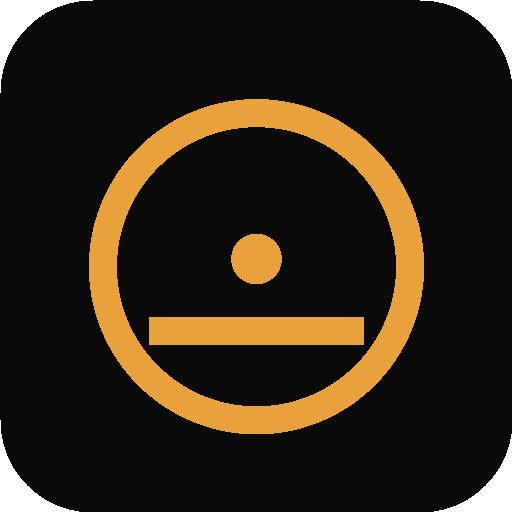

# Bhagwad Geeta

<div align="center">

  

  ### Read. Reflect. Return.

  A calm, offline-first way to read the Bhagavad Gita, explore its verses, and keep track of your practice.

  **Sanskrit · English · हिन्दी · नेपाली**

</div>

---

## ✨ What you can do

- **Read all 18 chapters** with Sanskrit text, transliteration, and translations.
- **Find a verse quickly** with search across Sanskrit, English, Hindi, and Nepali, or jump straight to a reference such as `2.47`.
- **Save your study** with verse highlights, notes, reading history, and chapter progress.
- **Build a daily practice** with the verse of the day, reading streaks, prayers, and guided topics.
- **Listen along** to chapter narration using your device’s speech support.
- **Keep reading offline.** The Gita text and core app experience are bundled on the device.
- **Back up with Google.** Sign in to sync your personal reading data through Firebase when you’re online. Your local reading data remains available offline.

## 📲 Install on Android

Download and install the current debug APK:

**[Get Gita-offline.apk](Gita-offline.apk)**

On your phone, open the APK and allow installation from that source if Android asks. This is a direct install build; it is not yet a Play Store release.

> Google sign-in and cloud backup need an internet connection. Reading the bundled scripture and using locally saved data work offline.

## 🛠️ Run the project

### Requirements

- Node.js and npm
- Android Studio / Android SDK for Android builds
- A Java runtime supported by the Android Gradle Plugin

### Local web preview

```sh
npm install
npm run serve
```

Open the local address printed by the server (normally `http://localhost:4173`).

### Build the Android app

```sh
npm install
npm run android:build
```

The debug APK is created at:

```text
android/app/build/outputs/apk/debug/app-debug.apk
```

The app’s Android application ID is `com.mezone.bhagawadgeeta`.

## ☁️ Google sign-in and backup

Google login and cloud backup require your own Firebase project configuration. See [FIREBASE_SETUP.md](FIREBASE_SETUP.md) for the setup steps and Firestore rules. Never commit private signing keys or service-account credentials.

The app stores reading data on the device and syncs account data to the signed-in user’s private Firestore path when online. Firebase is not needed to read the bundled Gita offline.

## 🧰 Built with

- HTML, CSS, and JavaScript
- [Capacitor](https://capacitorjs.com/) for the native Android app
- Firebase Authentication and Cloud Firestore for optional account sync

## 📁 Project map

```text
css/       App styles
data/      Bundled scripture data
icons/     App and web icons
js/        App screens, state, and cloud sync
android/   Capacitor Android project
scripts/   Local development and build helpers
```

---

Made for a little more reflection in every day. ॐ
